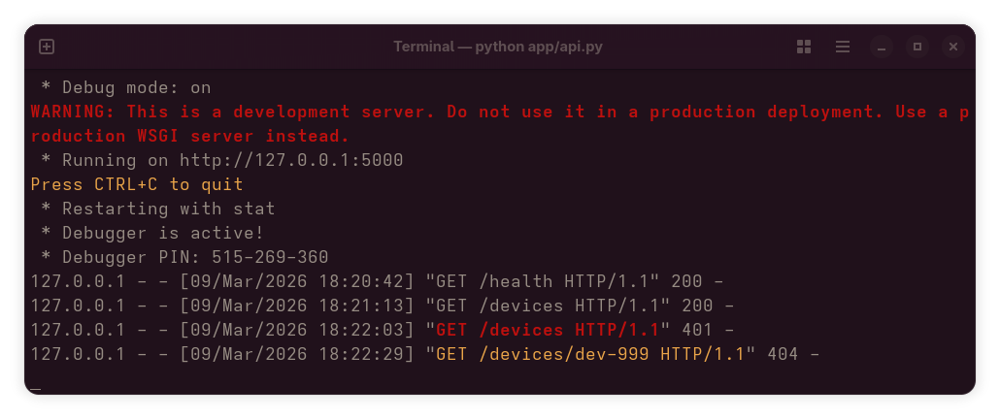
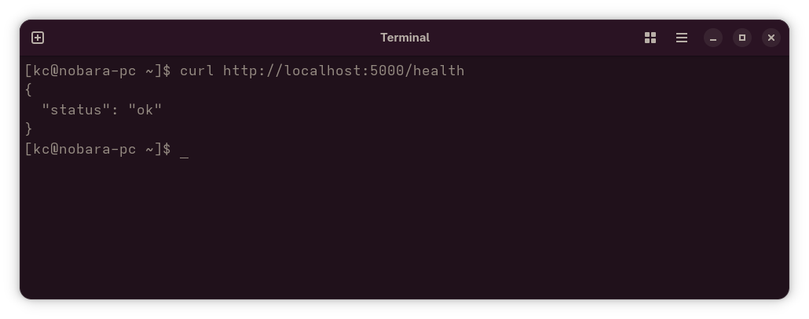
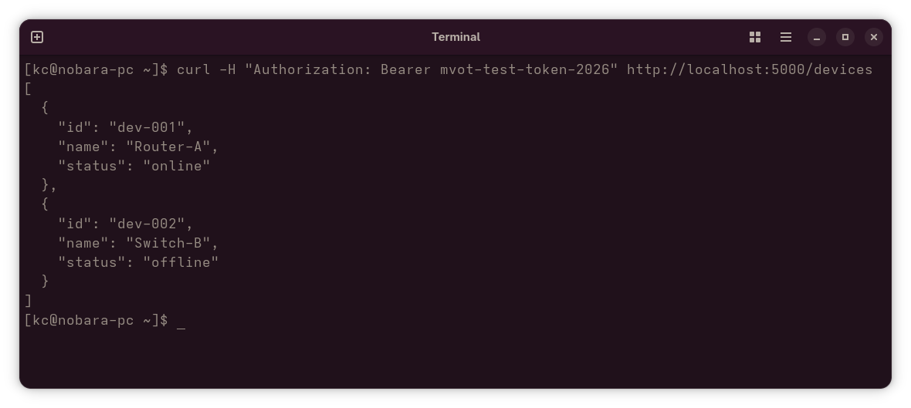
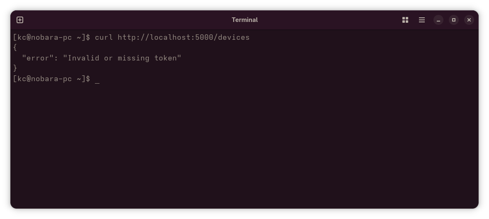
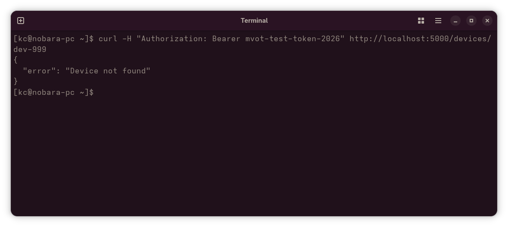
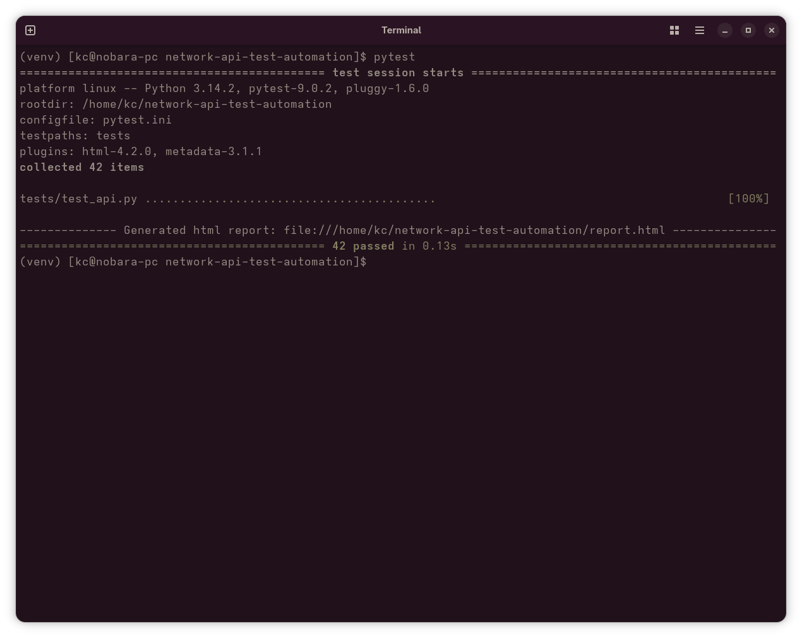
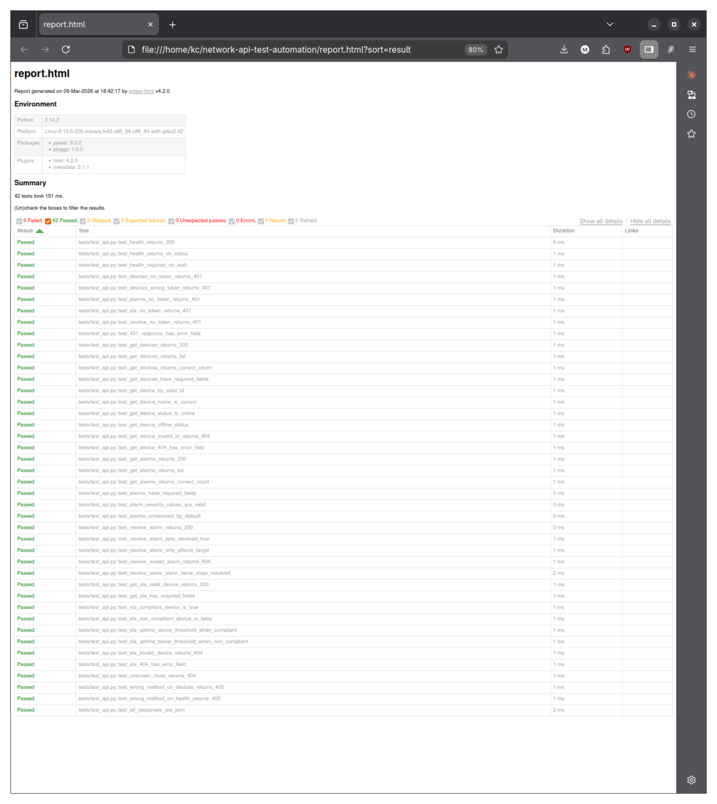
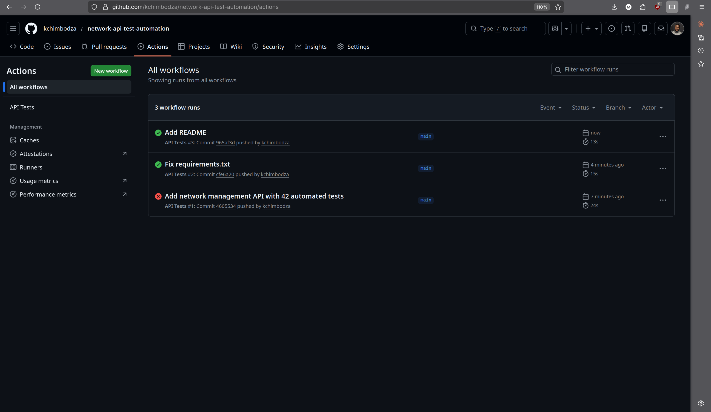

# Network API Test Automation

Automated functional test suite for a mock telecom network management REST API. Built to demonstrate API test design, CI/CD integration, and structured defect reporting.


## What it tests

| Endpoint | Method | Coverage |
|---|---|---|
| `/health` | GET | Service availability |
| `/devices` | GET | List devices, field validation |
| `/devices/<id>` | GET | Single device, 404 handling |
| `/alarms` | GET | List alarms, field and value validation |
| `/alarms/<id>/resolve` | POST | State change, isolation, idempotency |
| `/sla/<device_id>` | GET | SLA compliance logic, 404 handling |

## Test breakdown

- 42 automated test cases across health, auth, devices, alarms, SLA, and edge cases
- Auth: valid token, missing token, wrong token
- Happy path: correct responses and field presence
- Error handling: 404, 401, 405
- State: alarm resolution affects only the target record
- Edge cases: unknown routes, wrong HTTP methods, JSON content-type on all responses

## Stack

Python 3.12 | Flask | pytest | pytest-html | GitHub Actions

## Screenshots

### API running


### Health check


### Devices with valid auth


### No auth — 401


### Invalid device — 404


### pytest — 42 passed


### HTML test report


### GitHub Actions CI


## Run locally
```bash
python -m venv venv
source venv/bin/activate
pip install -r requirements.txt
PYTHONPATH=. pytest
```

HTML report is generated at `report.html` after each run.
